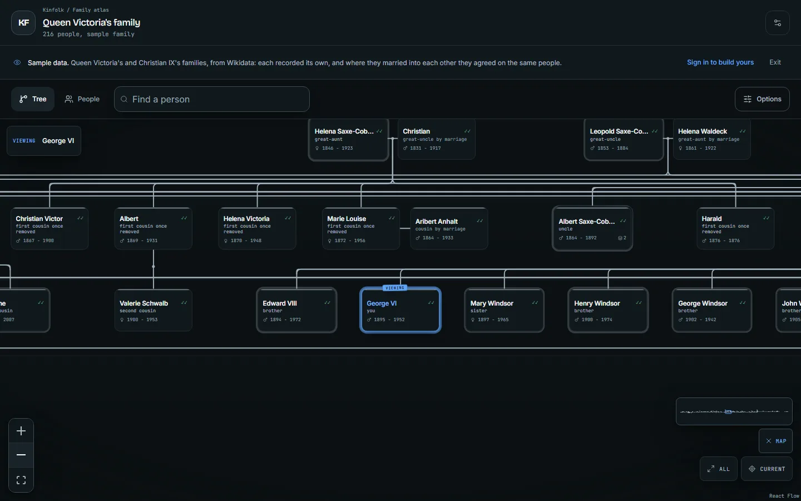
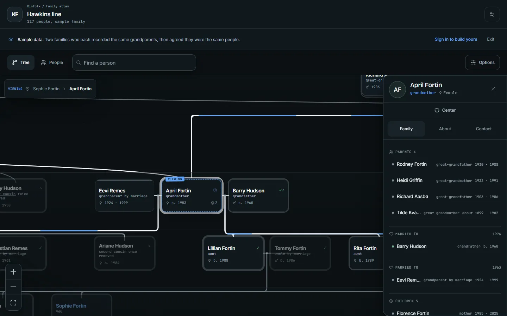
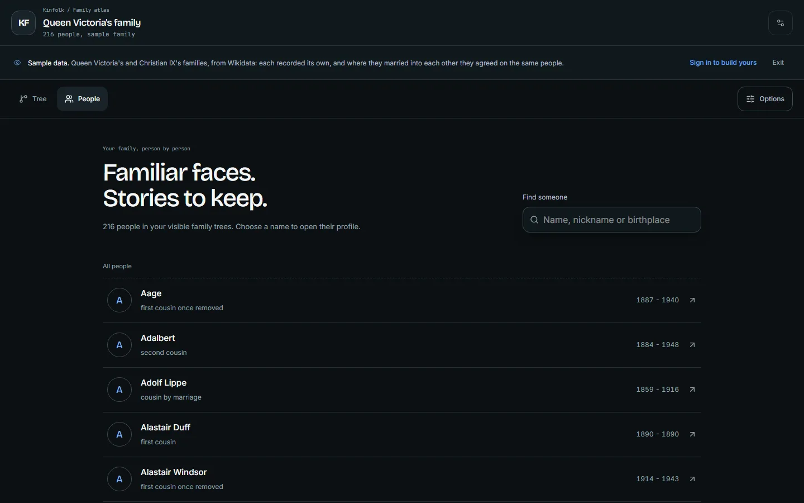
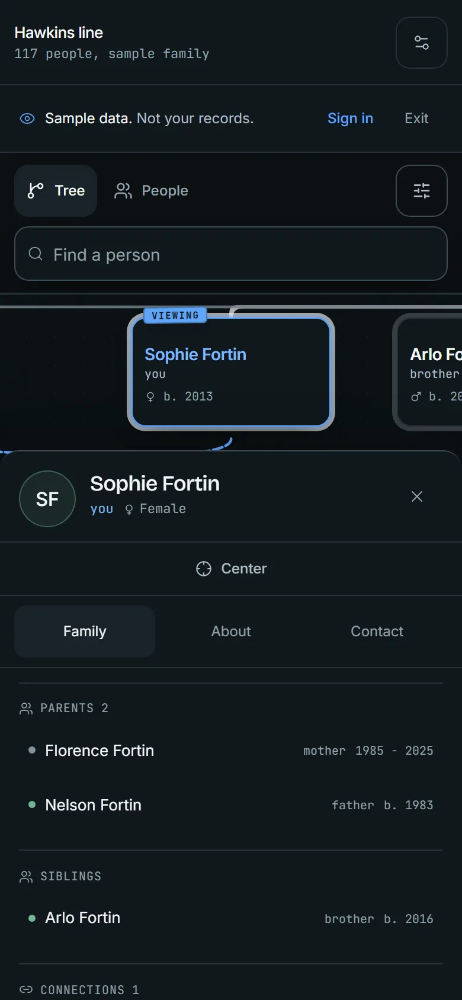

# Kinfolk

[](https://github.com/Sagargupta16/kinfolk/actions/workflows/ci.yml)
[](https://github.com/Sagargupta16/kinfolk/actions/workflows/health.yml)
[](LICENSE)

Collaborative family graph. Keep your own record, invite relatives, and join matching
people without overwriting either family's account.

**[sagargupta.online/kinfolk](https://sagargupta.online/kinfolk/)** -- the public SPA.
**[kinfolk-neon.vercel.app](https://kinfolk-neon.vercel.app/demo)** -- the API and
server-rendered fallback, with a sample tree you can explore without an account.

**Try it:** [open the sample tree](https://kinfolk-neon.vercel.app/demo). No sign-in needed; the
sample data is read-only.

[](https://vercel.com/new/clone?repository-url=https%3A%2F%2Fgithub.com%2FSagargupta16%2Fkinfolk&project-name=kinfolk&repository-name=kinfolk&env=AUTH_SECRET%2CAUTH_GITHUB_ID%2CAUTH_GITHUB_SECRET&envDescription=A%20random%20AUTH_SECRET%20and%20a%20GitHub%20OAuth%20app.%20The%20Neon%20integration%20supplies%20DATABASE_URL.&envLink=https%3A%2F%2Fgithub.com%2FSagargupta16%2Fkinfolk%2Fblob%2Fmain%2Fdocs%2FSELF-HOSTING.md&demo-title=Kinfolk&demo-description=Collaborative%20family%20graph%3A%20each%20relative%20keeps%20their%20own%20tree%2C%20consent%20links%20join%20them.&demo-url=https%3A%2F%2Fkinfolk-neon.vercel.app%2Fdemo&stores=%5B%7B%22type%22%3A%22integration%22%2C%22integrationSlug%22%3A%22neon%22%2C%22productSlug%22%3A%22neon%22%2C%22protocol%22%3A%22storage%22%7D%5D)
Run your own copy with a private Neon database: [docs/SELF-HOSTING.md](docs/SELF-HOSTING.md).



| Person profile | People directory | Phone |
| --- | --- | --- |
|  |  |  |

Screenshots are the live sample tree, captured by `pnpm screenshots` (Playwright). A light
theme [is available too](docs/screenshots/tree-desktop-light.webp).

Version **0.4.0** has been live since **2026-09-10**. It added a simpler family workspace,
consent-based record linking, private contact editing, and stronger safeguards for family
changes and deployment verification. **0.4.1** is a dependency and documentation refresh.
The [review and verification report](docs/verification-0.4.0.md) records the 0.4.0 fixes,
74 passing regression cases, and browser checks.
**0.5.0** adds screenshots, link previews, a Deploy button with a self-hosting guide, and a
layout benchmark. **0.6.0** adds relatives from `+` handles on the viewed card through one
small sheet, and removes the add and connect forms; see the [changelog](CHANGELOG.md).

## Why this is not just a tree widget

A family tree is not a tree. It is a directed acyclic graph, and the interesting problems are
social rather than visual:

- **The same human appears in several trees.** Your grandfather exists in your tree and in your
  cousin's. Both descriptions are legitimate and neither owner should lose their copy.
- **Merging must be non-destructive.** Kinfolk records "person A and person B are the same human"
  as a link that both sides consent to. Nothing is overwritten, and an unlink restores the
  separate views.
- **Parentage hangs off a union, not a parent pair.** Remarriages, half-siblings, single parents,
  and adoption are then ordinary data instead of special cases in the renderer.
- **Most genealogy data is missing or fuzzy.** `unknown` is a stored value, and approximate dates
  ("about 1890") have their own fields rather than being rounded into a lie.

It is also a contact graph, not only a pedigree. Anyone can be a node -- a friend, a
colleague, a neighbour -- and a friendship carries no generation, so it must never reach
the layout engine.

The long version, with the schema, the union-find that fuses trees, and why the layout
libraries were ruled out: [A family tree is not a tree](docs/a-family-tree-is-not-a-tree.md).

## Interface

Both frontends share a family atlas with light and dark themes, locally served fonts, blue
actions, and purposeful motion. Choose **Tree** for the family structure or **People**
for a searchable directory. Profiles separate **Family**, **About**, and **Contact**.
Appearance includes a persistent Full/Reduced motion choice, with Full as the default.

The family grows from the cards themselves. The person you are viewing carries a **+**
above their card for a parent, beside it for a partner, and below it for a child; a couple
shares one **+** under the pair. Each opens the same small sheet: a name, an optional
birth year, and two answers (Father or Mother, Husband or Wife, Son or Daughter), so the
button you press records the relationship and the sex at once. Siblings are added as
children of their parents, and a birth year orders siblings eldest first, so each
generation reads as a timeline. A connection can be removed from the person's
**Connections** section without deleting either person or changing structural family links.

Contact values stay on a separate authorized page. **Share** manages invitations;
**Link family records** in the account menu proposes a match for the other owner's consent.
Original records survive linking and unlinking. [Design notes](docs/experience-design.md)
explain the research and the adapted portfolio-react visual direction.

## Stack

| Layer | Choice |
| --- | --- |
| Framework | Next.js 16 (App Router) + React 19, TypeScript strict |
| Static frontend | Vite 8 + React 19, sharing the graph components and domain logic |
| Database | Neon Postgres via Drizzle |
| Auth | Auth.js v5, GitHub OAuth |
| Graph canvas | React Flow (`@xyflow/react`) with ELK layered layout |
| Styling | Tailwind 4 with shared light/dark family-atlas tokens |
| Motion | Motion 13, for chrome only |
| Tooling | pnpm, Biome |

The layout stack was measured against the alternatives rather than assumed: `family-chart`
and `relatives-tree` both require a binary gender on every node, which would corrupt a
record whose sex column defaults to `unknown`, and neither models non-family relations.
`d3-flextree` and `react-tree-graph` are strict trees, one parent per node. See CLAUDE.md
before swapping any of it out.

## Architecture

<picture>
  <source media="(prefers-color-scheme: dark)" srcset="docs/diagrams/architecture-dark.svg">
  <source media="(prefers-color-scheme: light)" srcset="docs/diagrams/architecture-light.svg">
  
</picture>

The spec behind the picture is [`docs/diagrams/architecture.yaml`](docs/diagrams/architecture.yaml), rendered with [orrery](https://github.com/Sagargupta16/orrery).

Key decisions:

- **A graph, not a tree.** Parentage hangs off `unions`, so a child can have two parents
  and a person several partners. ELK's layered layout handles that; friendships and other
  non-family relations never enter the layout graph.
- **Consent links instead of merges.** `person_links` records that two trees describe the
  same human. The other owner must accept, both source records stay intact, and unlinking
  restores the separate views.
- **Bearer token on Pages, cookie on Vercel.** Pages cannot run Auth.js, so the SPA posts
  the OAuth code to the API and keeps the returned token in `sessionStorage`. CORS is an
  exact allow list with no credentials header, which lets the fallback's session cookie stay
  `SameSite=Lax`.
- **Atomic writes without interactive transactions.** The Neon HTTP driver has no
  `db.transaction()`, so related writes go through `db.batch()` with duplicate, cycle and
  race checks.
- **Migrate, then verify.** The deploy workflow runs the committed SQL migrations (never
  `db:push`), then waits until Vercel serves the exact commit and `/api/health` reports the
  schema ready.

## Layout performance

`pnpm bench:layout` times the full layout (ELK plus Kinfolk's pedigree passes) on the
sample tree and on seeded generated families, in Node, on the same code path the browser
runs. It also times `elk.layout()` on its own, so the last two columns split the total
between ELK and Kinfolk's passes. One run on an Intel i9-14900HX laptop, Node 26.10,
median of 7 timed runs after 2 warm-ups:

| Graph | Nodes (people + unions) | Layout edges | Median | Fastest | ELK share | Kinfolk passes |
| --- | ---: | ---: | ---: | ---: | ---: | ---: |
| sample tree, 117 people | 151 | 150 | 124 ms | 108 ms | 99% | 2 ms |
| generated, 50 people | 60 | 59 | 32 ms | 30 ms | 98% | 1 ms |
| generated, 200 people | 243 | 242 | 161 ms | 149 ms | 99% | 2 ms |
| generated, 1000 people | 1232 | 1231 | 5706 ms | 5647 ms | 100% | 18 ms |

Three back-to-back runs on that machine gave 1,000-person medians of 5706, 5732 and
6290 ms, and the absolute numbers move with whatever else the machine is doing, so read
them as an order of magnitude and compare sizes within one run. Family-sized trees lay
out in well under a second. At every size ELK's layered layout is 97% or more of the
time, and because it runs on the main thread the canvas freezes until it returns; moving
ELK into a Web Worker is the planned fix.

## Local dev

```bash
pnpm install
```

Copy `.env.example` to `.env.local` and configure a separate development database or
branch, then create its schema:

```bash
pnpm db:push
```

```bash
pnpm dev --port 3007
```

The GitHub OAuth app needs its callback set to
`http://localhost:3007/api/auth/callback/github`.

`DATABASE_URL` must be the **direct** Neon host, not the `-pooler` one: the app is happy
either way over the HTTP driver, but `drizzle-kit push` opens a plain TCP connection the
pooler endpoint will not serve.

Full setup, click by click, is in [docs/SETUP.md](docs/SETUP.md).

## Test

```bash
pnpm lint
pnpm test
pnpm typecheck
pnpm --dir frontend typecheck
pnpm build
pnpm --dir frontend build
```

The regression suite uses synthetic records and an in-memory PGlite database running
the committed migrations. It covers OAuth state, exact dates, family roles, authorization,
atomic writes, record-link consent, contacts, and deployment probes. It needs no Neon
credentials and makes no production writes.

`pnpm screenshots` recaptures the README images and the Open Graph cards with Playwright
(run `pnpm exec playwright install chromium` once first), and `pnpm bench:layout` reruns
the layout benchmark above.

## Data model

Seven tables that matter, in `lib/db/schema.ts`:

- `trees` -- a workspace. One user can own several.
- `people` -- one tree's claim about a human.
- `unions` -- a partnership node. Both partner columns are nullable.
- `union_children` -- child membership, with biological / adoptive / step / foster / guardian role.
- `person_relations` -- every non-hierarchical connection (cousin, friend, colleague, mentor).
- `person_links` -- cross-tree identity assertions, consent-gated.
- `contact_details` -- one row per channel per person, each with its own visibility.

Plus `tree_members` and `tree_invites` for access grants and pending invitations. The
auxiliary `people_creation_budgets` table stores only per-tree counters used to reserve
creation capacity atomically; it contains no family records.

Access comes from tree ownership, an invitation that grants membership, or one hop
through an accepted record link. Pending proposals grant no access, and linked viewing
does not grant editing. Contact values are filtered server-side by audience and stay
off the canvas.

## Deployment

GitHub Pages builds `frontend/` and serves the public SPA at
[sagargupta.online/kinfolk](https://sagargupta.online/kinfolk/). It reuses the same graph
components and domain code as the Next app, then calls the JSON API on Vercel. Pages uploads
only the generated `frontend/dist` artifact, and production source maps are disabled.

Vercel serves the API, OAuth exchange, database writes, and the server-rendered fallback at
[kinfolk-neon.vercel.app](https://kinfolk-neon.vercel.app/). The SPA keeps its bearer token
in `sessionStorage`; the Vercel app keeps the stronger httpOnly-cookie flow available. This
split is necessary because Pages cannot run Auth.js, query Neon, or execute server actions.

<picture>
  <source media="(prefers-color-scheme: dark)" srcset="docs/diagrams/release-dark.svg">
  <source media="(prefers-color-scheme: light)" srcset="docs/diagrams/release-light.svg">
  
</picture>

The spec behind the picture is [`docs/diagrams/release.yaml`](docs/diagrams/release.yaml), rendered with [orrery](https://github.com/Sagargupta16/orrery).

`/api/health` checks database connectivity and required schema columns, plus
authentication configuration. Release probes require the expected
serving commit and verify protected routes, the sample API, and Pages assets.
An authentication-provider response alone does
not prove database readiness. `DATABASE_URL` is a manually configured encrypted
Vercel variable pointing at the existing Neon project; the native integration was removed
after it provisioned a separate empty database.

Details in [docs/DEPLOYMENT.md](docs/DEPLOYMENT.md). Changes are in
[CHANGELOG.md](CHANGELOG.md).

## Contributing and security

See [CONTRIBUTING.md](CONTRIBUTING.md) for the development workflow. Do not put real family
records, credentials, environment files, database dumps, or local MCP configuration in a
commit. Report vulnerabilities privately as described in [SECURITY.md](SECURITY.md).

## License

Kinfolk is available under the [MIT License](LICENSE).

## Status

Live in production: fusion across trees, the layered pedigree with sibling bars and
generation bands, an orbit arrangement, kinship terms on every card, reveal-on-focus
relations, light and dark themes, person cards, expand and collapse, the detail panel and
family feed as responsive reading sheets, search, a People directory, view options, a
census-driven legend, adding relatives by relationship, precise removal of non-structural
connections, person editing, sign-in, sharing by invite, record-link proposals and consent,
private contact editing, deletion of unclaimed records, and demo mode. Most of this has
been live since 0.4.0 (2026-09-10). 0.6.0 moves adding relatives onto `+` handles on the
viewed card and removes the panel for connecting existing people; its server actions remain.

Photo uploads still need an approved private-storage provider and authentication flow.
Avatars use initials. Profiles linked to an account cannot be deleted; other deletion
flows preserve the surviving parent's children and require confirmation.
